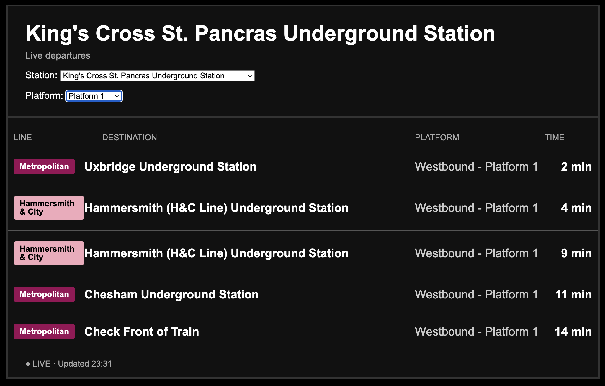

# 🚇 TfL Departures

A live London Underground departure board that runs in your browser. Pick any Tube station, optionally filter by platform, and see the next trains arriving, styled like the boards you'd see on the platform.

Built with **FastAPI** and the official **[TfL Unified API](https://api-portal.tfl.gov.uk/)**.



## Features

- **Every Tube station**: the station list is pulled straight from TfL, sorted A–Z
- **Platform filter**: platforms are detected dynamically for whichever station you pick
- **Next 3 departures** with destination, platform and time to arrival ("Due" when under a minute)
- **Official line colours** for all 11 Tube lines, plus the Elizabeth line
- **Auto-refresh** every 30 seconds, with an "Updated HH:MM" timestamp

## Getting started

### 1. Get a TfL API key

Sign up for free at the [TfL API Portal](https://api-portal.tfl.gov.uk/), subscribe to the default product, and copy your primary key.

### 2. Clone and install

```bash
git clone https://github.com/musaabdurrahman/tfl-departures.git
cd tfl-departures

python -m venv .venv
source .venv/bin/activate      # Windows: .venv\Scripts\activate

pip install fastapi uvicorn requests python-dotenv
```

### 3. Add your key

Create a `.env` file in the project root:

```env
TFL_API_KEY=your_key_here
```

`.env` is already in `.gitignore`, so your key won't be committed.

### 4. Run it

```bash
uvicorn app:app --reload
```

Then open **http://127.0.0.1:8000** in your browser.

## API endpoints

The app also exposes a small JSON API that the board uses itself:

| Endpoint | Description | Example |
| --- | --- | --- |
| `GET /stations` | All Tube stations (id + name), sorted alphabetically | `/stations` |
| `GET /departures` | Next 3 trains at a station, optionally filtered by platform | `/departures?station=940GZZLUKSX&platform=Platform 1` |
| `GET /platforms` | Platforms that currently have trains arriving at a station | `/platforms?station=940GZZLUKSX` |

Station IDs are TfL NaPTAN codes. Tube stations start with `940GZZLU` (King's Cross St. Pancras is `940GZZLUKSX`). FastAPI also gives you interactive docs at **http://127.0.0.1:8000/docs**.

## Project structure

```
tfl-departures/
├── app.py      # FastAPI app: API routes + the departure board page
├── test.py     # Quick script for exploring the TfL StopPoint API
└── .gitignore
```

## Acknowledgements

Powered by TfL Open Data. This project isn't affiliated with or endorsed by Transport for London.
